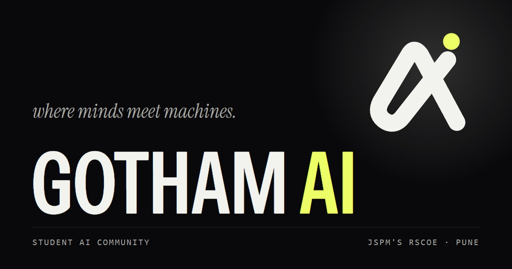

<p align="center">
  
</p>

# Gotham AI

Gotham AI is a student-led AI and technology community at JSPM's Rajarshi Shahu College of
Engineering (RSCOE), Tathawade, Pune. We run technical sessions, workshops and hackathons, and
our members build real projects with industry partners.

**[gotham-ai.vercel.app](https://gotham-ai.vercel.app)** ·
[Events](https://gotham-ai.vercel.app/events) ·
[Projects](https://gotham-ai.vercel.app/projects) ·
[Join](https://docs.google.com/forms/d/e/1FAIpQLSc3ns7PZxGni5YExgTcGIsX-f_95syZ5__7tKeA9Wt4YKLMBw/viewform) ·
gothamjspm@gmail.com

This repository is the community's website.

## Run it locally

```bash
cd frontend
npm install
npm run dev        # http://localhost:5173
```

That's all you need for the site. The backend only handles the contact form:

```bash
cd backend
npm install
cp .env.example .env   # EMAIL_USER, EMAIL_APP_PASSWORD (Gmail app password), ADMIN_EMAIL
npm run dev
```

## How it's built

- **React, Vite and Tailwind**, with GSAP and Lenis for motion and a three.js night city in the hero.
- **Static and prerendered.** Every page is built to plain HTML, so it loads fast and search
  engines and AI assistants can read all of it. The build also writes `sitemap.xml`,
  `llms.txt` and a Markdown copy of every page.
- **Content as files.** Each event, project, resource and person is one file in
  `frontend/src/content/`. There is no database or CMS.
- **A small Express backend** whose only job is emailing contact-form messages.

```
frontend/
  src/content/    events, projects, resources, team: one file each
  src/pages/      routes
  src/components/ UI
  scripts/        prerender, content and SEO checks
backend/          contact form → email
docs/             content and SEO guides
```

## Adding an event

Copy `frontend/src/content/events/_template.js`, name it after the event, fill it in and put
the photos in `frontend/public/img/`. It then shows up everywhere: home page, events, search,
sitemap and structured data. Events dated in the future are marked **Upcoming** automatically.
Projects and resources work the same way.

`npm run build` checks the content and the SEO of every page, and fails if something is missing.
For every field and rule, see [docs/content-guide.md](docs/content-guide.md) and
[AGENTS.md](AGENTS.md).

## Contributing

Found a bug or a typo? Open an issue or a pull request. Members of Gotham AI can help with
events, projects and the site itself; reach us at gothamjspm@gmail.com.

Led by [Aayush Deshpande](https://www.linkedin.com/in/aayushdeshpande-/) (Founder & President),
[Prasad Bhalerao](https://www.linkedin.com/in/prasadbhalerao/) (Vice President) and
[Vipul Nanaware](https://www.linkedin.com/in/vipul-nanaware-549801211/) (Social Media and Marketing Lead).
